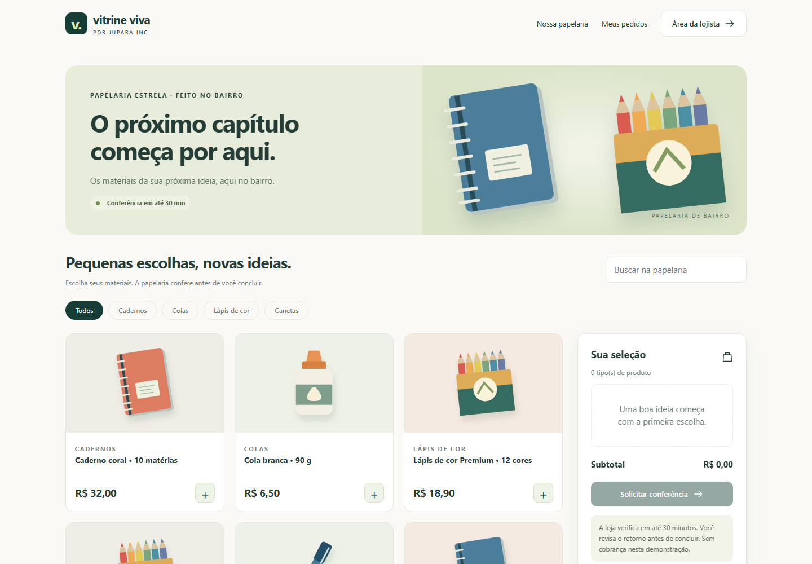

# Vitrine Viva

**Da loja física à primeira venda online. Um protótipo da Jupará Inc. para o evento 7ª edição · Hackathon Connect 7.0**

A lojista organiza o catálogo e registra movimentações de estoque pelo painel. A cliente seleciona produtos na vitrine, envia uma pré-compra e aguarda a conferência. Se algum item estiver esgotado, pode escolher uma alternativa do catálogo ou seguir sem ele. A conclusão registra o pedido demonstrativo e dá baixa no estoque.



## Executar localmente

Requer **Node.js 24 ou superior**, com npm. Clone ou baixe este repositório e execute o comando na pasta `vitrine-viva`.

```sh
npm start
```

Abra a [vitrine](http://localhost:3000) ou a [área da lojista](http://localhost:3000/#admin). A senha padrão da demonstração local é `jupara-demo`.

O projeto usa APIs nativas do Node.js e SQLite, sem dependências externas do npm. A instalação inicial inclui seis produtos fictícios de uma papelaria. O banco fica em `data/vitrine.sqlite` e persiste após reiniciar o servidor.

## O que funciona

| Recurso | Estado nesta versão |
| --- | --- |
| Vitrine | Catálogo, pesquisa, categorias, seleção e acompanhamento da pré-compra |
| Painel da lojista | Autenticação, configuração guiada da loja, cadastro e edição de produtos com foto |
| Assistente local | Prepara rascunhos a partir de descrições em um formato demonstrativo |
| Estoque e pedidos | Histórico de movimentações, conferência, alternativas do catálogo e baixa transacional |
| Gemini | Extração de áudio, foto, texto e PDF. Requer configuração e revisão humana dos rascunhos |
| Telegram | Notificação, cadastro e conferência. Requer bot e chat privado configurados |
| Tray | Exportação local do catálogo em JSON disponível. Integração com a Tray pendente |

A pré-compra aguarda a conferência sem reservar estoque. A conclusão preserva os preços do pedido, revalida os saldos e registra as saídas uma só vez. O fluxo é demonstrativo e opera sem pagamento, frete ou emissão fiscal.

## Documentação

- [Demonstração](docs/DEMONSTRACAO.md) cobre a jornada da pré-compra à baixa de estoque com dados fictícios e sem credenciais externas.
- [Configuração](docs/CONFIGURACAO.md) explica as variáveis de ambiente, Gemini, Telegram, Tray e Docker.
- [Contrato da API](docs/API.md) detalha as rotas, a autenticação e as regras do pedido.

Para rodar a aplicação online, use uma hospedagem com Node.js e armazenamento persistente. A opção com Docker está no guia de configuração.

## Testes

```sh
npm test
```

A suíte usa bancos temporários e cobre autenticação HTTP, isolamento dos pedidos, estoque, rollback, idempotência, alternativas e rascunhos. O GitHub Actions executa a suíte no Linux e no Windows com Node.js 24. Os conectores externos dependem de validação com as credenciais do ambiente de uso.

## Estrutura

| Caminho | Conteúdo |
| --- | --- |
| `public/` | Vitrine, painel responsivo e ilustrações locais |
| `src/server.js` | Servidor HTTP, rotas e autenticação |
| `src/store.js` | Persistência SQLite, estoque e ciclo do pedido |
| `src/extract.js` | Interpretador local de descrições e conector Gemini |
| `src/telegram.js` | Bot e notificações do Telegram |
| `tests/` | Testes de domínio e HTTP |
| `docs/` | Demonstração, configuração e API |

## Equipe

- Wagner
- Jhonnatas
- Douglas


Projeto apresentado pela **Jupará Inc.**.

## Referências técnicas

- [Telegram Bot API](https://core.telegram.org/bots/api)
- [Telegram Bots FAQ](https://core.telegram.org/bots/faq)
- [Gemini GenerateContent](https://ai.google.dev/api/generate-content)
- [Node.js SQLite](https://nodejs.org/api/sqlite.html)
